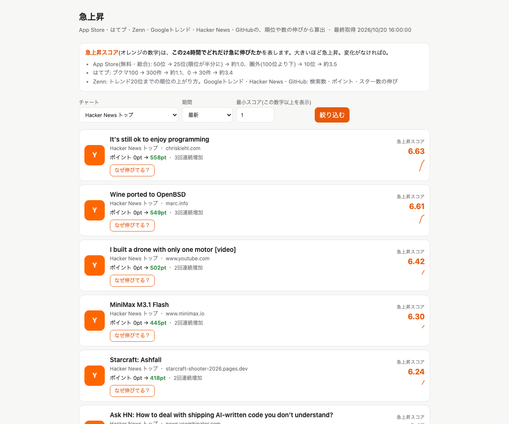

# find-buzz ― 「まだ小さいが急に伸びているもの」を拾うツール

個人開発・事業開発のネタ探し用に、App Store・はてブ・Zenn・Googleトレンド・Hacker News・GitHub のランキングや数値を定期的に取得し、**規模ではなく伸び率**で「プチバズ」を一覧にするツールです。毎朝、急上昇の上位をSlackに通知します。

- 公開URL: https://find-buzz.youth1975.workers.dev/
- 各項目の「なぜ伸びてる？」を押すと、Claude が Web 検索で背景を調べ、「何か・なぜ今・切り口」の3行で説明します



## 作った理由

Googleトレンドは粒度が大きく、世の中全体の話題しか出てきません。若年層の間で流行り始めたアプリのように、**まだ小さいが急に伸びているもの**に早く気づくためのツールとして作りました。最初のユーザーは自分自身です。

## 取得元

| 取得元 | 取得方法 | 判定に使う値 | 頻度 |
|---|---|---|---|
| App Store 無料・総合 | Apple 公式の RSS Generator | 順位の変化（100位より下は圏外） | 1日4回 |
| はてなブックマーク 人気エントリー（7カテゴリ） | 公式 RSS | ブックマーク数の伸び | 1日4回 |
| Zenn トレンド | 公式 RSS | 順位の変化（20位まで） | 1日4回 |
| Googleトレンド 急上昇 | 公式 RSS | 検索数の伸び | 毎時（RSSが直近1時間の10件しか返さないため） |
| Hacker News トップ・Show HN | 公式 API | ポイントの伸び | 1日4回 |
| GitHub 新着リポジトリ（7日以内） | Search API | スター数の伸び | 1日4回 |

公式の RSS・API だけを使っています。App Store の旧 iTunes RSS は robots.txt で自動取得が禁止されているため使わず、はてなは案内どおりアクセスの間隔を数秒あけています。X（旧Twitter）の API は、バズを探すには大量に読んで捨てる必要があり従量課金で費用が膨らむため、使っていません。

## 構成

```
GitHub Actions（定期実行）
  └ scripts/fetch.ts … 各取得元から取得
      └ POST /ingest（トークン認証）
          └ Cloudflare Worker（Hono）
              ├ スコアを計算して D1 に保存
              ├ GET /            … 急上昇一覧（サーバーで描画）
              ├ POST /background … 「なぜ伸びてる？」（Claude API ＋ Web検索）
              └ Cron（毎朝7:30）… Slack にダイジェストを送信
```

- 実行環境: Cloudflare Workers ＋ D1（SQLite）
- 言語・ライブラリ: TypeScript、Hono（JSX でサーバー描画）、Anthropic SDK
- 定期取得: GitHub Actions

## 技術選定と設計判断

### 1. バズは「件数」ではなく「伸び率」で判定する

「いいね◯件以上」のような絶対値では、もともと大きいものしか拾えません。24時間前と比べてどれだけ伸びたかをスコアにしています（`src/score.ts`）。

- **順位系（App Store・Zenn）**: 上位ほど1つ順位を上げるのが難しいので、順位は対数比で扱います。50位→25位と100位→50位は同じ「半分」として評価し、7日平均との比と、連続して上がった回数も加えています
- **数値系（はてブ・HN・GitHub・Googleトレンド）**: `log((今の値+1) / (24時間前の値+1))`。人気エントリーに載る前は計測していないので、載っていなかった回は0件とみなします
- スコアは取得したときに計算して `signals` テーブルに保存し、画面と通知はそこだけを読みます。表示のたびに履歴を集計しません

### 2. 取得元ごとに処理を分け、1つが落ちても全体は止めない

取得処理は `src/sources/` に取得元ごとに分け、共通の型（`FetchedItem`）で返します。保存は `Promise.allSettled` でチャートごとに独立させ、失敗したチャートは `fetch_runs` にエラーとして記録し、ほかのチャートは保存を続けます。

### 3. 取得は GitHub Actions、保存と表示は Worker

当初は Worker の Cron で取得していましたが、Apple の RSS が Cloudflare からのアクセスを 403 で拒否するため、取得だけを GitHub Actions に移しました。Worker は `/ingest` で結果を受け取ります（Bearer トークンをハッシュしてから定数時間で比較）。

- Actions の cron は毎時0分に混雑して遅れたり飛ばされたりするため、17分・37分にずらしています
- cron が数分〜数十分遅れても回ごとの比較がずれないよう、観測時刻は時単位に丸めています

### 4. D1 のバインド数の上限を JSON で回避する

D1 は1クエリに渡せるパラメータ数に上限があるため、100件単位の行は配列を JSON 文字列1つで渡し、SQLite の `json_each` で展開して一括で INSERT しています（`src/collect.ts`）。

### 5. 「なぜ伸びてる？」は公開ページから叩かれる前提で守る

Claude（Web検索・Web取得ツールつき）で背景を調べます（`src/background.ts`）。

- 同じ項目の結果は24時間キャッシュし、1日（日本時間）の生成回数に上限（既定30回）を設けて、API の使い過ぎを防ぐ
- 別サイトから叩かれないよう、同じオリジンからのリクエストだけを受け付ける
- 根拠が見つからないときは推測で埋めず「はっきりした理由は見つかりませんでした」と書かせる。古い記事を今回の理由として扱わないよう、2週間以内の情報を優先させる
- ツールを使う合間の途中経過の文が混ざらないよう、最後のツール結果より後のテキストだけを答えとして読む
- Web 検索が長引いて途中で止まった場合は、続きを促して最大4回まで再開する

## ディレクトリ構成

```
src/
  index.tsx     ルーティング（一覧・/ingest・/background）と Cron
  ui.tsx        一覧画面（Hono JSX）
  score.ts      急上昇スコアの計算（純粋関数）
  collect.ts    取得結果の保存とスコア計算の呼び出し
  queries.ts    一覧・通知用のクエリ
  notify.ts     Slack ダイジェスト
  background.ts 「なぜ伸びてる？」の生成とキャッシュ
  sources/      取得元ごとのアダプター
scripts/
  fetch.ts      GitHub Actions から実行する取得スクリプト
migrations/     D1 のスキーマ
.github/workflows/
  fetch.yml         1日4回の取得
  fetch-hourly.yml  Googleトレンドの毎時取得
```

## 動かし方

```bash
npm install
cp .dev.vars.example .dev.vars   # SLACK_WEBHOOK_URL / INGEST_TOKEN / ANTHROPIC_API_KEY
npm run db:migrate:local
npm run dev                      # http://localhost:8787
npm run typecheck
```

## 開発について

設計・実装・検証には AI コーディングエージェント（Claude Code）を用いています。最初に要件と判断材料を [HANDOFF.md](HANDOFF.md) にまとめ、それを読ませて計画を立てるところから始めました。
